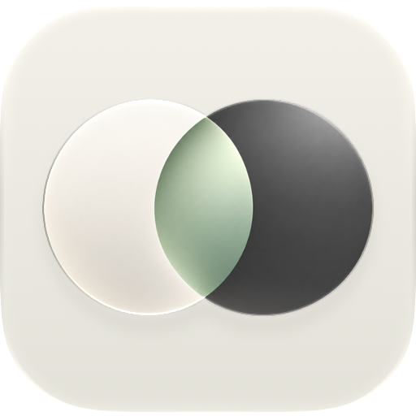

# Meet&See (觅见)

<p align="center">
  
</p>

A native macOS launcher for local file and application search. Built with Swift and AppKit. Chinese, mixed Chinese/English, and multi-keyword queries work without relying on Spotlight's name matching.

Meet&See runs as a menu bar app. Press the hotkey, type, and open the result. It is intentionally small: local search and fast opening, without workflows, clipboard history, or a plugin system.

## Highlights

- **Chinese-friendly matching.** Substring matching for Chinese, case/width/diacritic-insensitive matching, mixed Chinese/English keywords, and keyword order independence.
- **Whitelist and blacklist.** Control which folders and file types are included, and exclude folders, extensions, keywords, Finder aliases, or symbolic links.
- **Pinned items.** Bind a query to a file, folder, or URL. Pinned targets always rank first and also match Pinyin and initials.
- **Application search.** Matches localized application names, bundle names, English names, Pinyin, and initials.
- **Contacts.** Optional local Contacts search by full name or full Pinyin. `Command-C` copies a clean phone number.
- **System Settings search.** Opens first- and second-level System Settings pages by name.
- **Four highlight themes.** Celadon (天青), Soft White (柔白), Blue Tag (蓝标), and Porcelain (釉绿). Celadon, Soft White, and Blue Tag use native HDR/EDR rendering on supported displays. Blue Tag and Porcelain use a solid body; Porcelain pairs a flat ivory panel with a glaze-green selection and ink text. Graphite (石墨) is hidden; existing Graphite preferences fall back to Celadon.
- **Native materials.** Uses `NSGlassEffectView` on macOS 26 and falls back to native vibrancy on older systems.
- **Local only.** No telemetry, no network requests, no file-content upload.

## Requirements

- macOS 13 or later.
- macOS 26 or later for the Liquid Glass appearance.
- The published build is Apple Silicon (arm64). Intel Macs can build from source.

## Install

Download the latest zip from [Releases](https://github.com/JC-SYSU/meetsee/releases), unzip it, and move `MeetSee.app` to `/Applications` before enabling "Launch at login". The app's display name is 觅见.

The release binary is **ad-hoc signed**, not notarized by Apple. On first launch, macOS blocks it until you approve it:

1. Double-click the app once and dismiss the warning.
2. Open **System Settings → Privacy & Security**.
3. Click **Open Anyway**, authenticate, and confirm.

If the button does not appear, double-click the app again to re-trigger the check, or remove the quarantine flag manually:

```bash
xattr -dr com.apple.quarantine /Applications/MeetSee.app
```

Ad-hoc signatures do not have a stable designated requirement. After installing an update, macOS may ask again for Full Disk Access, Contacts, or Finder automation.

## Build from source

Prerequisites:

- Xcode command-line tools with `actool` and Icon Composer support (Xcode 26 or later recommended).
- Rust and Cargo for the bundled engine.

```bash
./build.sh                 # builds build/觅见.app
./test.sh                  # runs the test suite
bash launch.sh             # launches the built app in the background
```

`build.sh` accepts an output path:

```bash
./build.sh build/MeetSee.app
```

Signing is configurable:

- Default: use the local `CopyLocalDev` self-signed identity when present, so TCC grants survive rebuilds; otherwise fall back to ad-hoc.
- `SIGNING_IDENTITY=<name> ./build.sh` uses a specific identity.
- `SIGNING_IDENTITY=- ./build.sh` forces ad-hoc signing, which is what public release builds use.

Release builds are produced with `SIGNING_IDENTITY=-`. No Apple Developer ID or notarization is used.

## Permissions

| Permission | When | Required? |
|---|---|---|
| Full Disk Access | Reading protected folders such as `~/Documents`, `~/Downloads`, or other apps' containers | Optional. Without it, macOS prompts per folder. |
| Contacts | Contacts search | Optional. The feature is off by default. |
| Finder automation | `Command-I` opens the native Finder info window | Optional. macOS prompts on first use. |

Meet&See does not request Accessibility, Input Monitoring, or Screen Recording. It never changes Alfred or Spotlight settings.

## Search engines

Meet&See has two file-search engines. New installs use the native engine.

- **Native.** A Swift in-process indexer with deterministic substring matching, built to avoid the Chinese name-matching behavior that motivated the project.
- **Bundled engine.** A headless Rust helper built from [lokii-core](https://github.com/huangy7/lokii) v0.1.9 (MIT), vendored under `ThirdParty/lokii` and patched.

The bundled engine is optional. No Lokii installation is required. In normal operation, Meet&See does not launch or communicate with the official Lokii app, its CLI, its global configuration, or its Unix socket. The source tree retains a legacy socket client and TOML helpers for historical tests; production code uses the bundled helper.

The patch is limited to five files: TCC-aware protected-path handling, cache applicability, and watcher state reporting. Details are in [`ThirdParty/lokii/README.md`](ThirdParty/lokii/README.md) and [`docs/lokii.md`](docs/lokii.md).

The bundled engine returns at most 5,000 raw matches per query. Filtering, application matching, pinned items, contacts, and system-settings results stay in Swift. The two engines are not byte-for-byte equivalent: the native engine remains the reference for matching behavior.

Meet&See is an independent project. It is not affiliated with or endorsed by the Lokii project.

## Keyboard shortcuts

| Shortcut | Action |
|---|---|
| `Command-Space` | Show or hide the search panel |
| `Up` / `Down` | Move selection |
| `Return` | Open with the default application |
| `Command-Return` | Reveal in Finder |
| `Command-I` | Open the native Finder info window |
| `Command-Shift-C` | Copy the full path |
| `Command-R` | Refresh the index |
| `Command-1` … `Command-N` | Open the Nth candidate; numbering is fixed to the result list, not the scroll position |
| `Escape` | Hide the panel |
| `Command-,` | Open settings |
| `Command-Q` | Quit |

`Command-Space` conflicts with Spotlight by default. Disable or change the Spotlight shortcut in System Settings, or choose another hotkey in Meet&See's settings.

## Privacy

All indexing and matching happen on the local machine. The app has no telemetry, analytics, or network requests. Contacts are read only when the feature is enabled and are kept in memory. Search results and phone numbers are not written to diagnostic logs.

## Documentation

- [`docs/behavior.md`](docs/behavior.md) — search behavior, filters, ranking, and settings.
- [`docs/architecture.md`](docs/architecture.md) — process model and source layout.
- [`docs/lokii.md`](docs/lokii.md) — bundled engine, patch notes, and license boundaries.
- [`PROVENANCE.md`](PROVENANCE.md) — origin, placeholder identifier, and third-party scope.
- [`THIRD-PARTY-NOTICES.md`](THIRD-PARTY-NOTICES.md) — third-party components and licenses.
- [`CONTRIBUTING.md`](CONTRIBUTING.md) — build, test, and pull-request workflow.
- [`SECURITY.md`](SECURITY.md) — private vulnerability reporting.
- [`RELEASING.md`](RELEASING.md) — release checklist.

## License

Meet&See is licensed under the **GNU General Public License v3.0 or later**. See [`LICENSE`](LICENSE).

Third-party components remain under their own licenses. In particular, `ThirdParty/lokii` is MIT-licensed upstream; the vendored copy and the combined work are distributed under GPL-3.0-or-later, with the MIT notice preserved.

The name "Lokii" and the Lokii logo belong to the Lokii project. Meet&See uses the name only to describe the bundled engine's origin.
